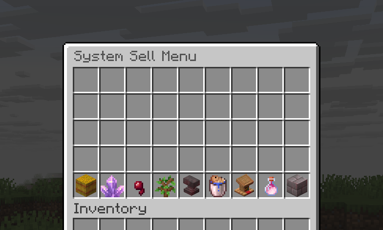
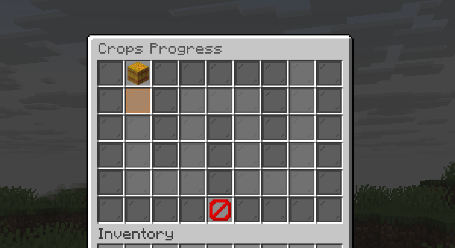
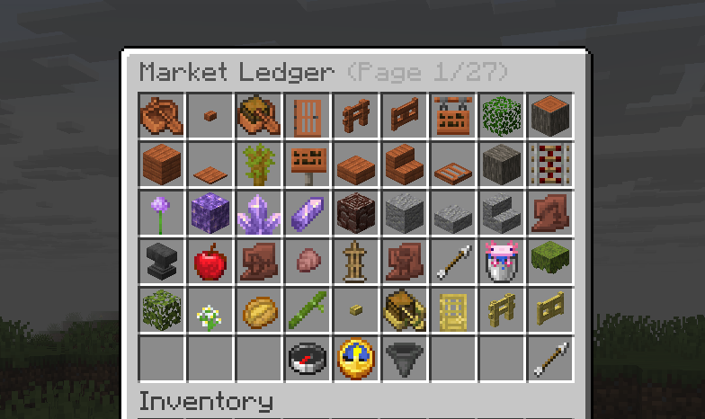
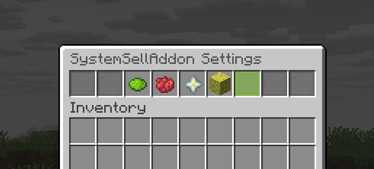
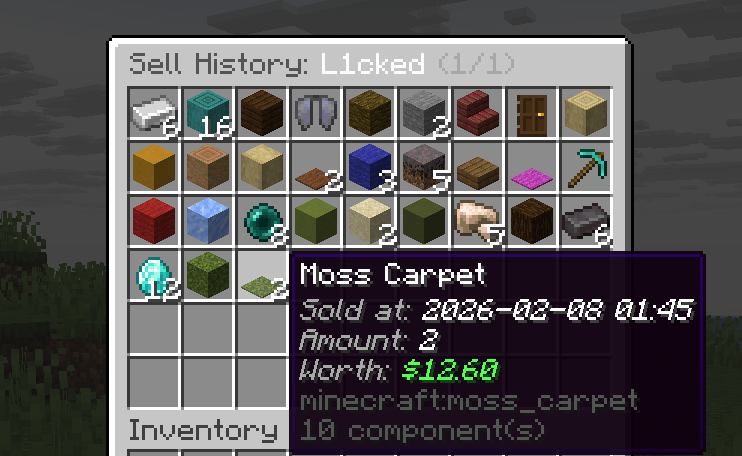

# SystemSellAddon

Selling plugin for Paper with category multipliers, a worth browser, and optional history.


**Version:** 1.0.0

> **MIT License**
> This project is licensed under the MIT License.
> See `LICENSE` for full terms.


## Highlights
- Category-based selling via GUI with progress and multiplier tiers
- Worth browser (/worth) with sorting and filtering
- Optional per-sell history (SQLite) and itemized logs
- Shulker selling support with worth calculated from items inside + shulker box worth
- Worth-lore overlay (requires ProtocolLib)
- API events for integrations (plus MayorSystem callbacks when present)

## Screenshots










## Requirements
- Paper 1.21.x (api-version: 1.21)
- Java 21
- Vault (required) + any Vault economy provider (EssentialsX Economy, EzEconomy, etc.)

## Optional Integrations
- ProtocolLib: enables live worth lore in inventories
- MayorSystem: receives payout callbacks automatically when installed, and imports `mayor-perks` into its own config on first start

## Install
1. Drop the jar into `plugins/`.
2. Install Vault and an economy provider.
3. Start the server to generate configs.
4. Customize `config.yml` and `prices.yml`.
5. Reload with `/systemselladdon reload` or the Settings menu.

## Commands
Player commands:
- `/sell` - Open the Sell GUI.
- `/sell history` - Open your sell history (requires `history.enabled`).
- `/worth` - Open the Worth (price list) GUI.
- `/worth <item>` - Check the price for an item (material name).

Admin/staff commands:
- `/sell history <player>` - Open another player's history (requires permission and `history.enabled`).
- `/setworth <item> <price>` - Set a price for a material already listed in `prices.yml`.
- `/systemselladdon` - Show plugin info.
- `/systemselladdon settings` - Open the Settings GUI.
- `/systemselladdon reload` - Reload config and prices.
- `/systemselladdon resetworth [player|all]` - Clear worth lore for players.

Notes:
- History GUIs are player-only; console cannot open them.

## Permissions
- `systemselladdon.reload` - Reload plugin configuration (default: op)
- `systemselladdon.history.other` - View /sell history for other players (default: op)
- `systemselladdon.setworth` - Edit prices with /setworth (default: op)
- `systemselladdon.settings` - Open Settings menu (default: op)
- `systemselladdon.resetworth` - Clear worth lore via command or settings (default: op)

## Menus
- Sell GUI: main sell interface. Put items in slots 0-35 and click category icons to view progress.
- Progress GUI: per-category progress and next multiplier milestones.
- Worth GUI: paginated price list with sort and filter controls.
- Settings GUI: toggle plugin, toggle history, reload config, ProtocolLib status.
- History GUI: paginated list of sold items with timestamps and worth (when enabled).


## Configuration
All files live in `plugins/SystemSellAddon/`:

`config.yml`
- `settings.enabled` - Toggle all selling
- `settings.base-multiplier`, `multiplier-increment`, `max-multiplier`
- `settings.worth-lore.enabled` and `settings.worth-lore.format`
- `level-prices` - Formula-driven cost per multiplier level (or list mode)
  - Formula: `price = base * growth^(level*exponent) + add-per-level*level`, clamped by `min`/`max`
  - `max-levels` controls how many tiers the Progress GUI shows
- `database` - Storage backend for player data + history (requires restart to change)
  - `type`: `sqlite` or `mysql`
  - `sqlite.file`: file name or path (default `data.db`)
  - `mysql.*`: host, port, database, username, password, ssl, params
- `message-settings.show-item-breakdown`
- `messages.*` - Supports `{prefix}` placeholder
- `history.enabled`, `history.page_size`, `history.breakdown_max`, `history.retention_days`
- `mayor-perks.*` - Perk definitions consumed by MayorSystem (synced into MayorSystem config on startup)

`prices.yml`
- Prices are grouped by category. Category keys must match:
  `CROPS`, `ORES`, `MOBS`, `NATURAL`, `ARMOR_AND_TOOLS`, `FISH`, `BOOK`, `POTIONS`, `BLOCKS`.

GUI customization:
- The GUI is hardcoded in the plugin (no `gui.yml`). To change layout/icons/text, edit `GUIManager`.

## Configuration Examples
- [Example config.yml](docs/examples/config.yml)
- [Example prices.yml](docs/examples/prices.yml)

## Data Storage
- SQLite: player data in `plugins/SystemSellAddon/data.db`, history in `plugins/SystemSellAddon/systemselladdon.db`
- MySQL: player data + history in the configured database

## API / Events
Integrations can listen to:
- `SystemSellAddonPayoutSummaryEvent` (totals only)
- `SystemSellAddonPayoutEvent` (totals + per-category breakdown)

Services:
- `SystemSellAddonApi` is registered with Bukkit's ServicesManager.

Note: SystemSellAddon payouts already include the internal multiplier. Apply external bonuses after the event.

## Build
```bash
./gradlew clean jar
```
This produces the thin upload jar in `build/libs/` (no shaded dependencies).
Runtime dependencies are downloaded by Paper/Spigot from `plugin.yml -> libraries` at server startup.

Optional local fat jar (not for upload):
```bash
./gradlew shadowJar
```

## License
This project is licensed under the MIT License.

Copyright (c) 2026 Lou Morel (Canada)

See `LICENSE` for the full text.

## Support
Open an issue with:
- Server version
- Plugin version
- Steps to reproduce
- Relevant config sections
